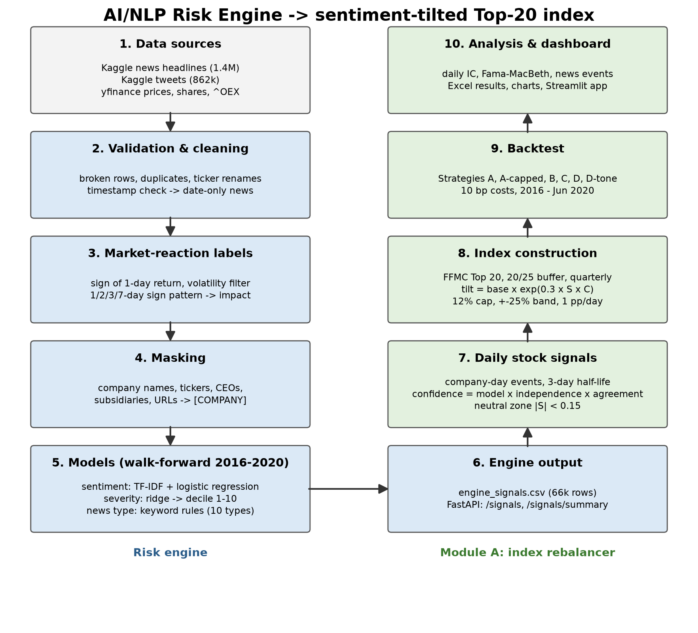

# AI/NLP Financial Risk Engine with a Sentiment-Tilted Top-20 Index - S&P Global & Crisil Campus Hackathon

**Candidate Name:** Raman Dubey **College Email ID:** ramandubey@kgpian.iitkgp.ac.in **College / Campus:** Indian Institute of Technology, Kharagpur
**Demo Video Link:** [youtube] **Slide Deck Link (if hosted externally):** https://canva.link/z89m9p1zvgyv43h (Also submitted)


## 1. Project Overview / Problem Statement & Approach

**Problem.** Build an AI/NLP Risk Engine that reads financial text from at least two sources and outputs, for
each item, a sentiment score (-1 to 1), an impact score (1-10) and a news/event type, served through a file or an
API. Then use those signals in a downstream module. I built **Module A: a sentiment-driven index rebalancer** with
a dashboard of weights over time.

**Approach.**

- **Two text sources:** S&P 100 news headlines (2016 to June 2020) and stock tweets (2017-2018), both from Kaggle.
- **Labels from the market, not from opinion.** A headline is labelled by what the stock actually did: the
  sign of the next close-to-close return, kept only when volatility rose after the news and the 1/2/3/7-day return
  pattern was consistent. The impact label is the size of that move. No human labelling was needed.
- **No shortcuts for the model.** Company names, tickers, CEOs and subsidiaries are masked, so the model cannot
  learn "Company X = up". Data is split by date, never randomly.
- **Models.**
  - Sentiment: TF-IDF + logistic regression. It beat FinBERT embeddings on validation and is fast and explainable.
  - Impact: a ridge regression on the size of the move, mapped to deciles 1-10.
  - News type: transparent keyword rules (10 categories).
  - Every headline from 2016 to 2020 is scored **out of sample**: the models are retrained each year on past
    data only (walk-forward).
- **Index (Module A).** A sentiment-tilted Top-20 index:
  - Each quarter, pick the 20 largest current S&P 100 companies by free-float market cap (FFMC), with a buffer.
    A member stays while it ranks in the top 25, and a newcomer must reach the top 20.
  - Start from FFMC weights and tilt each stock by `exp(0.30 x S x C)`. S is the stock's recent news sentiment
    (newer news counts more; half-life of 3 trading days). C is a confidence score: how sure the model is, how
    many separate news items there are, and whether they agree. Small signals (|S| < 0.15) are ignored.
  - Risk controls: at most 12% per stock, at most ±25% away from the FFMC weight, and at most 1 percentage point
    of change per day between reviews.
  - Backtested daily with 10 bp trading costs and compared with a plain FFMC index and the S&P 100 (`^OEX`).

**Main finding (an honest one).** The engine reads the news well: 70% accuracy per company-day on the
same-day move. But the move is already in the price by the next close. Every test of next-day prediction is
close to zero, so the sentiment tilt neither helps nor hurts the index in a meaningful way. Section 5 has the
numbers.

## 2. Architecture & Tech Stack



A file-by-file walkthrough of the repository is in [`docs/PROJECT_GUIDE.md`](docs/PROJECT_GUIDE.md).

| Layer | What it does | Code |
|---|---|---|
| Data validation | Raw-data checks, broken-row repair, duplicates, timestamp check | `src/inspect_data.py` |
| Labels | Market-reaction sentiment and impact labels | `src/labels.py`, `src/prices.py` |
| Masking | Hides company names, tickers, people, URLs | `src/text_prep.py` |
| Models | Sentiment, severity, news type, walk-forward scoring | `src/modeling.py`, `src/run_model.py`, `src/severity.py`, `src/news_type.py`, `src/walk_forward.py` |
| Engine output | CSV + REST API | `src/build_engine_output.py`, `src/api.py` |
| Index data | S&P 100 prices, shares, splits, free float, cleaning | `src/index_data.py` |
| Index | Universe, FFMC ranking, reviews, weights and constraints | `src/universe.py`, `src/weights.py` |
| Signals | Daily stock sentiment S, confidence C, neutral zone | `src/signals.py` |
| Backtest | Strategies, costs, metrics, Excel export, charts | `src/backtest.py`, `src/export_results.py`, `src/charts.py` |
| Analysis | Daily IC, Fama-MacBeth, news-event performance | `src/analysis.py` |
| Dashboard | Streamlit app | `app.py`, `src/dashboard_data.py` |

**Tech stack:** Python 3.11, pandas, numpy, scikit-learn, scipy, PyTorch (CPU) + Hugging Face transformers
(FinBERT comparison), yfinance, FastAPI + uvicorn, Streamlit + plotly, matplotlib, openpyxl. Exact versions are in
`requirements.txt`. Every module in `src/` has a plain-script test in `tests/`.

## 3. Dataset Used

| Source | Use | Link |
|---|---|---|
| Kaggle "Daily Financial News for 6000+ Stocks" (`analyst_ratings_processed.csv`, 1.4M headlines, 2009 to 2020-06-11) | Main news source | https://www.kaggle.com/datasets/miguelaenlle/massive-stock-news-analysis-db-for-nlpbacktests |
| Kaggle "Tweet Sentiment's Impact on Stock Returns" (`full_dataset-release.csv`, 862k tweets, 2017-2018) | Social source | https://www.kaggle.com/datasets/thedevastator/tweet-sentiment-s-impact-on-stock-returns |
| yfinance | Prices, share counts, splits, free float, `^OEX`, `^IRX` (risk-free rate) | cached in `data/prices/` |
| Financial PhraseBank | Benchmark only (human-labelled tone) | `data/phrasebank/` |
| S&P 100 constituents (Wikipedia, as of 2026-09-21) | Index universe | `data/universe/sp100_constituents.csv` |

**Re-downloading the raw data.** `data/raw/` is not committed (the files are too large for GitHub). Download both
Kaggle datasets (a free Kaggle account is needed) and unzip them to:

```
data/raw/news/     analyst_ratings_processed.csv, raw_analyst_ratings.csv, raw_partner_headlines.csv
data/raw/tweets/   full_dataset-release.csv, reduced_dataset-release.csv
```

Everything else used (prices, processed labels, signals, outputs) is already in `data/`. The backtest, analysis
and dashboard run without the raw files.

**Assumptions and limitations.**

- **News is date-only.** The minute timestamps failed my reliability check (only 74.5% consistent against a 95%
  bar). A headline dated d is therefore first used at the close of the next trading day (d+1), and the weights
  set then earn the return from d+1 to d+2. This is the only lag in the pipeline.
- **Free float:** today's free-float factors are held constant over 2016-2020. BRK.B's 0.85 is my estimate,
  because yfinance's figure for it is broken.
- **Survivorship bias:** today's S&P 100 members are used for 2016-2020, which flatters every strategy against
  `^OEX`.
- **`^OEX` is a price index** (no dividends), about 2% a year easier to beat. Strategy A (no sentiment) is the
  fair comparison.
- **Coverage:** some large members have no headlines (MSFT, BRK.B, CVX) or very few, so they never tilt.
- **Tweets carry no direction signal** (51% accuracy) and are not used in the index backtest.
- **Costs:** 10 bp per unit of weight traded; market impact is not modelled.

## 4. Quickstart & Installation

Tested with Python 3.11.3 on Windows 11. Run these in Windows PowerShell, one after another, on a fresh clone.
**The raw Kaggle data is NOT needed for the demo:** the processed data, model outputs and backtest results are in the repo.

1. Clone the repository.
   ```powershell
   git clone https://github.com/Raman676/Code-to-connect-challenge.git
   ```
   You should see: `Cloning into 'Code-to-connect-challenge'...` and then `done.`

2. Go into the project folder.
   ```powershell
   cd Code-to-connect-challenge
   ```
   You should see: the prompt now ends in `Code-to-connect-challenge>`.

3. Create a virtual environment.
   ```powershell
   python -m venv .venv
   ```
   You should see: no output; a new `.venv` folder appears.

4. Activate it.
   ```powershell
   .\.venv\Scripts\Activate.ps1
   ```
   You should see: the prompt starts with `(.venv)`. If PowerShell blocks the script, run
   `Set-ExecutionPolicy -Scope Process -ExecutionPolicy Bypass` first (this window only), then try again.

5. Install the packages (CPU build of PyTorch; a few minutes).
   ```powershell
   pip install -r requirements.txt --extra-index-url https://download.pytorch.org/whl/cpu
   ```
   You should see: a line starting with `Successfully installed` at the end.

6. Run all tests (about 1 minute).
   ```powershell
   python run_tests.py
   ```
   You should see: one `PASS` line per test file, then `23/23 test files passed`.

7. Start the dashboard.
   ```powershell
   streamlit run app.py
   ```
   You should see: `Local URL: http://localhost:8501`, and the dashboard (tabs Index, Weights, Signals feed,
   Engine results, Sensitivity) opens in the browser. Press Ctrl+C to stop it.

8. Start the REST API (in the same window after Ctrl+C, or in a second window with `.venv` activated).
   ```powershell
   uvicorn src.api:app
   ```
   You should see: `Uvicorn running on http://127.0.0.1:8000`. Open http://127.0.0.1:8000/docs for the API page;
   http://127.0.0.1:8000/health returns `{"status":"ok","rows":66158,"file":"engine_signals.csv"}`.

**Re-running the backtest and analysis** (optional, also from the committed data). Set
`$env:PYTHONIOENCODING='utf-8'` first, then:

```powershell
python src/backtest.py           # all strategies -> docs/backtest_report.txt, data/outputs/backtest_results.xlsx, docs/figures/  (~4 min)
python src/analysis.py           # daily IC, Fama-MacBeth, news events -> docs/analysis_report.txt                          (~1 min)
```

**Full pipeline from the raw Kaggle files (in this order).**

| # | Command | Output | Time (CPU) |
|---|---|---|---|
| 1 | `python src/inspect_data.py` | `docs/data_inspection.txt` | ~3 min |
| 2 | `python src/labels.py` | `data/processed/labels_*.csv`, `docs/labels_report.txt` | ~1 min |
| 3 | `python src/run_model.py` | `docs/model_report.txt` | ~20 min |
| 4 | `python src/model_checks.py` | `docs/model_checks.txt` | ~11 min |
| 5 | `python src/severity.py` | `docs/severity_report.txt` | ~2 min |
| 6 | `python src/index_data.py` (`--refresh` re-downloads) | `data/prices/sp100_*`, `docs/index_data_checks.txt` | ~2 min |
| 7 | `python src/walk_forward.py` | `data/processed/signals_walkforward.csv` | ~45 min |
| 8 | `python src/news_type.py` | news-type counts, `docs/news_type_check.csv` | <1 min |
| 9 | `python src/build_engine_output.py` | `data/outputs/engine_signals.csv` | <1 min |
| 10 | `python src/backtest.py` | backtest report, Excel, CSVs, charts | ~4 min |
| 11 | `python src/analysis.py` | `docs/analysis_report.txt` | ~1 min |
| 12 | `python src/architecture.py` | `docs/architecture.png` | seconds |

### Testing

```powershell
python run_tests.py
```

This runs every `tests/test_*.py` file in its own process, prints a PASS/FAIL line per file and the total, and exits
with a non-zero code if any file fails. One file can also be run on its own, e.g. `python tests/test_weights.py`.
No raw data, network or model download is needed.

| Test file | What it checks |
|---|---|
| `test_analysis.py` | Daily IC, Fama-MacBeth regression, news-event and window returns (`src/analysis.py`) |
| `test_api.py` | REST API endpoints and filters, on a small made-up signals file (`src/api.py`) |
| `test_app.py` | The Streamlit dashboard runs headless on the real output files; every tab renders without errors |
| `test_architecture.py` | The architecture diagram is drawn and its steps are in pipeline order |
| `test_backtest.py` | Backtest engine: weight drift, trading costs, the one-day news lag, performance and benchmark metrics |
| `test_build_engine_output.py` | The engine output file (columns and values), from small made-up inputs |
| `test_charts.py` | Active-signal count and that all four chart PNGs are written |
| `test_dashboard_data.py` | The dashboard's data loading and filtering helpers |
| `test_export_results.py` | Summary (^OEX first), yearly returns, average tilt, all Excel sheets and the dashboard CSVs |
| `test_index_data.py` | S&P 100 data helpers: share-count cleaning and back-fill, free-float factors, review dates (no network) |
| `test_inspect_data.py` | Raw-data inspection helpers, on tiny made-up CSV files |
| `test_labels.py` | Market-reaction labels: date anchoring, return and volatility windows, sign patterns and impact table |
| `test_model_checks.py` | Model-check helpers (no model download) |
| `test_modeling.py` | Sentiment scoring, baselines, TF-IDF model, embedding cache and the date split with a gap |
| `test_news_type.py` | The keyword rules that assign the 10 news types |
| `test_prices.py` | Price caching logic, with a fake downloader (no network) |
| `test_sentiment_data.py` | Loading and processing the Financial PhraseBank benchmark |
| `test_severity.py` | The impact (severity 1-10) model, on small made-up data |
| `test_signals.py` | Stock-level sentiment and confidence: decay, 15-day window, events, neutral zone, lag |
| `test_text_prep.py` | Company-name masking and the per-company-day tweet cap |
| `test_universe.py` | Index membership: quarterly reviews, exact 20 members with the 20/25 buffer, FFMC |
| `test_walk_forward.py` | Walk-forward: yearly training windows with gaps and no leakage, next-day return timing |
| `test_weights.py` | Base weights, sentiment tilt, 12% cap, tilt band and 1 pp daily limit |

**API example:** `http://127.0.0.1:8000/signals?ticker=AAPL&start=2020-03-01&end=2020-03-31&source=news`

## 5. Key Results & Domain Impact

**Risk engine** (`docs/engine_report.txt`)

| Test | Result |
|---|---|
| Sentiment vs market label, news test (Nov 2019 - Jun 2020) | 60.9% per headline, **69.9% per company-day** (majority class 51.1%) |
| Walk-forward, every headline 2016 - Jun 2020 (out of sample) | 57.2% per headline, 60.4% per company-day |
| FinBERT-tone, no training, same items | 58.1% / 62.4% |
| **Next-day check** (return entirely after the news) | **49.6%**; rank correlation with the next-day return 0.013 |
| Severity: Spearman with the actual move size (walk-forward) | 0.443; mean move 0.81% at impact 1 rising to 4.26% at impact 10 |
| Tweets | 50.7%: no direction signal |
| Engine output | 66,158 rows (64,028 news + 2,130 tweets), 90 tickers, CSV + API |

News types: Earnings 19.6%, Analyst Rating 14.8%, M&A 2.7%, Geopolitical 2.3%, Management Change 1.8%,
Legal 1.1%, Product Launch 1.0%, Macro 1.0%, Credit Event 0.2%, Other 55.5%.

**Index backtest, 2016-01-04 to 2020-06-30** (`docs/backtest_report.txt`, `data/outputs/backtest_results.xlsx`)

| Strategy | Total return | CAGR | Volatility | Sharpe | Max drawdown | TE / IR vs `^OEX` | TE / IR vs A | Turnover / yr |
|---|---|---|---|---|---|---|---|---|
| `^OEX` (parent index, price only) | 59.2% | 10.93% | 19.35% | 0.571 | -31.5% | - | 3.76% / -1.37 | - |
| A: FFMC Top 20 | 98.7% | 16.55% | 20.35% | 0.795 | -29.7% | 3.76% / 1.37 | - | 19.0% |
| A-capped: A with 12% cap at reviews | 97.6% | 16.41% | 20.28% | 0.791 | -29.7% | 3.68% / 1.36 | 0.23% / -0.61 | 20.1% |
| B: sentiment tilt, no confidence | 97.8% | 16.44% | 20.34% | 0.791 | -29.6% | 3.78% / 1.34 | 0.10% / -0.98 | 99.6% |
| C: tilt x confidence | 98.8% | 16.56% | 20.35% | 0.796 | -29.6% | 3.77% / 1.37 | 0.06% / 0.13 | 41.4% |
| **D: C + risk controls** | 96.4% | 16.25% | 20.25% | 0.786 | -29.6% | 3.67% / 1.33 | 0.31% / -0.91 | 50.4% |
| D-tone: D with FinBERT-tone | 95.9% | 16.18% | 20.25% | 0.783 | -29.6% | 3.67% / 1.31 | 0.32% / -1.09 | 68.9% |

TE = tracking error, IR = information ratio. `^OEX` is the primary benchmark; Strategy A isolates the news tilt.
`^OEX` is price-only while the strategies include dividends, so active return vs `^OEX` is overstated by roughly
the dividend yield (~2% a year); tracking error is barely affected.

- **Sensitivity:** a stronger tilt makes D worse. With alpha 0.3 / 1.0 / 3.0, D's active return vs Strategy A is -0.28 /
  -0.33 / -0.44% a year, because turnover rises from 50% to 156% a year and the extra cost outweighs any signal.
- **Does sentiment predict beyond FFMC and price?** (`docs/analysis_report.txt`) No:
  - Daily IC (cross-sectional rank correlation with the next-day return): mean 0.0099, t = 1.40, positive on 52.5%
    of days.
  - Fama-MacBeth: the sentiment coefficient's t-stat is 0.99 after controlling for 1-day and 5-day past returns.
- **Stress periods:**
  - On the top 1% of news-heavy days (all late February to mid-March 2020), D lost 14.7 bp in total vs A.
  - Over the COVID window (19 Feb - 30 Apr 2020), every strategy was within 0.1 pp of A's -9.1%.
- Most of the indexes' outperformance against `^OEX` is dividends and survivorship bias, not skill.

**Domain impact.**

- The engine turns unstructured news into a clean, typed, out-of-sample signal feed (CSV + API) that a risk or
  index team can query by company, date, source and news type.
- The index framework is transparent and auditable: FFMC selection with a buffer, an explicit tilt formula,
  hard risk limits, costs, and one clearly stated information lag.
- The negative result is useful in itself. Headline sentiment from free public data is priced in within a day, so
  an index team should use it for **monitoring and risk flags** (which members have heavy or negative news),
  not as a return signal. Beating the market with it would need faster (intraday) data.

All design decisions are logged with their reasons in `DECISIONS.md`.

**License:** MIT, see `LICENSE`.
